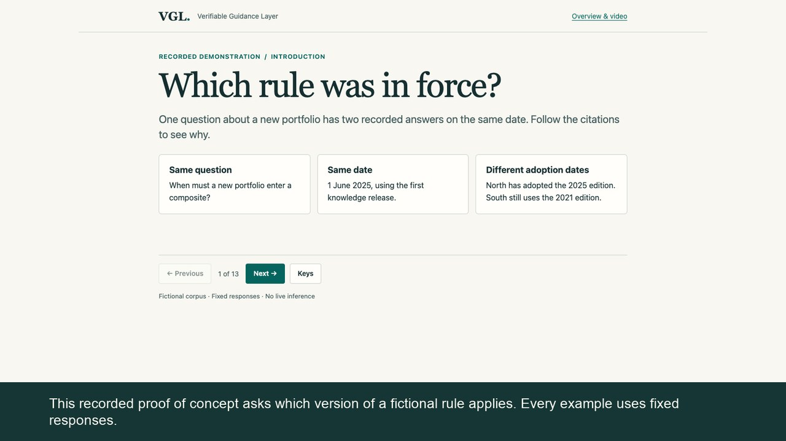
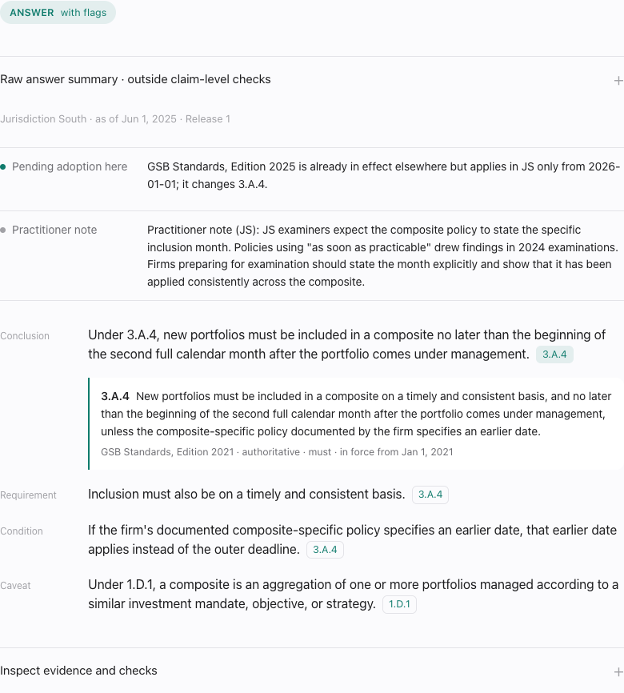

# Verifiable Guidance Layer

[](https://ericediger.github.io/VGL/website/vgl/media/vgl-walkthrough.mp4)

**[▶ Watch the 75-second walkthrough](https://ericediger.github.io/VGL/website/vgl/media/vgl-walkthrough.mp4)** · silent, with captions · [transcript](https://ericediger.github.io/VGL/website/vgl/media/transcript.html)

The video steps through the recorded walkthrough, which is exported from this repository's replay run on a fictional corpus. [Step through the walkthrough yourself](https://ericediger.github.io/VGL/website/vgl/#1.1).

A portfolio proof of concept for checking answers against versioned guidance. Ask when a new portfolio must enter a composite in the fictional North and South jurisdictions. On the same date, the two editions give different deadlines. Each retained claim points to the version used.

## Explore

- [Recorded walkthrough](https://ericediger.github.io/VGL/website/vgl/#1.1) and [project overview](https://ericediger.github.io/VGL/website/vgl/review/), served by GitHub Pages from `website/vgl/`.
- [Illustrated PDF](docs/vgl-walkthrough.pdf) and [MP4 walkthrough](https://ericediger.github.io/VGL/website/vgl/media/vgl-walkthrough.mp4).
- [Architecture](docs/01-architecture.md), [design decisions](docs/03-decisions.md), [fictional corpus](docs/00-corpus-spec.md), [evaluation](docs/eval-report.md) and [limitations](docs/limitations.md).

The website plays back saved results. The local application replays the recorded intake, embedding, selection, composition and secondary review steps. PostgreSQL resolves versions and relationships, and Python checks the structured claims. A fixed recorded input produces the same response under the same code, corpus and release. This edition makes no live model calls.

## Run locally

With Docker Compose installed, run these commands from the repository root.

```sh
docker compose up -d --build
```

Open [the local application](http://127.0.0.1:8000).



The initial build downloads public packages and images. Replay needs no account, provider key or environment file. The app binds to loopback and the database is available inside the Compose project. The fixed database credentials belong only to this local demo.

Select **G1** or **G2**, then **Ask**. Both ask “By when must a new portfolio be added to a composite?” Keep the example's controls. The North case cites the 2025 edition and the South case cites the 2021 edition. **G4a** demonstrates a missing ruling. In **Releases**, preview and approve the Q&A to enable **G4b**. Approve the amendment next for **G11a** and **G11b**. Reset returns the local demonstration to release 1. Unrecorded requests can return HTTP 409.

```sh
docker compose run --rm app pytest
docker compose stop
```

The suite creates a separate test database in this local project. Its generated reports go under `build/evaluation/` inside the test container. The committed reports come from a complete replay run. The 13 authored cases measure specified outcomes and citations. Citation checks alone cannot establish semantic correctness. See the [case-by-case results](docs/eval-report.md).

## Website files

The portable static files, PDF, videos, captions and poster travel together under `website/vgl/`. GitHub Pages publishes them from `main`. Open `website/vgl/review/index.html` for the overview or serve `website/` with `python3 -m http.server --bind 127.0.0.1 --directory website 8080` and visit [the local overview](http://127.0.0.1:8080/vgl/review/). The [publication instructions](docs/publication.md) cover hosting these files.

## Project and terms

Eric Ediger defined the requirements, architecture, evaluation scenarios and scope, used AI coding tools to implement and iterate on the proof of concept, and reviewed its behavior against those requirements. The standards, entities and examples are fictional. This is a portfolio publication. No open-source license is granted for the project. [Third-party components](docs/third-party.md) retain their own licenses. [Contact](https://ericediger.com/about)
