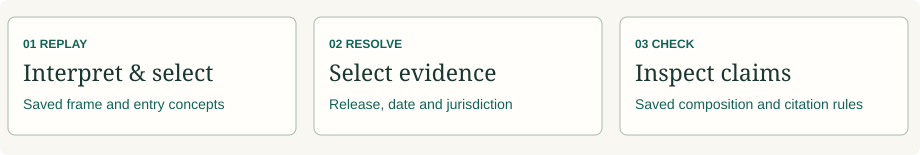

# How an answer is assembled

1. Intake replays a structured frame. The caller supplies date and jurisdiction. Missing controls or required facts can produce a clarification.
2. Retrieval combines full-text and vector rankings. A recorded selection chooses among the shortlisted concepts. The resolver follows typed dependencies under a release watermark and chooses versions using date and local adoption. The default depth is four.
3. A recorded composition supplies candidate claims. The verifier checks for missing citations, versions outside the retrieved packet, superseded versions, known carve-outs, unresolved references and practitioner-only authority. It removes failed claims. A failed conclusion or a known unresolved reference can route the answer to review.
4. A saved secondary review can flag semantic disagreements. The interface displays the retained claims, citations and flags. The raw summary is available in a labeled detail view.

PostgreSQL stores document versions, concepts, edges, release membership and embeddings. The app can preview a proposed change, publish it into a new local release and compute which issued answers depend on superseded versions. Preview compares evidence for authored cases. It does not run the full composed-answer evaluation.

The runtime modules follow the stages in `src/vgl/`. Inspect `closure.py` for selection and traversal, `verify.py` for the output contract, `releases.py` for change impact and `pipeline.py` for the fields persisted with an answer.
